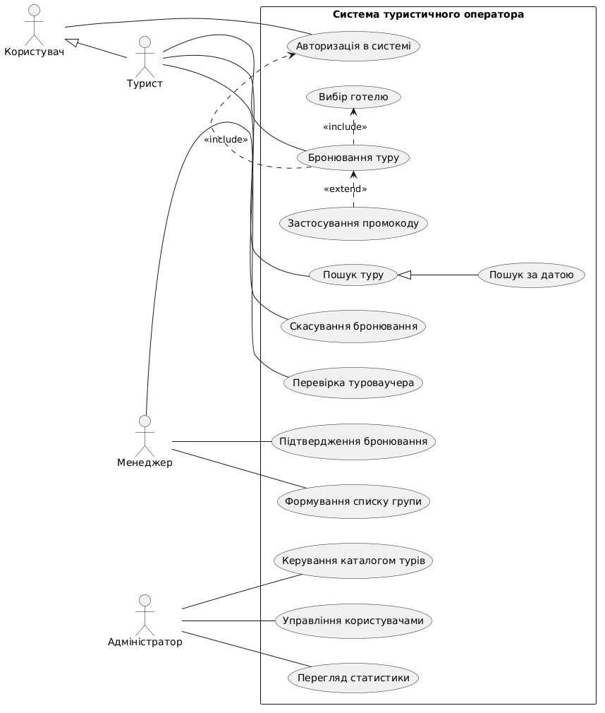
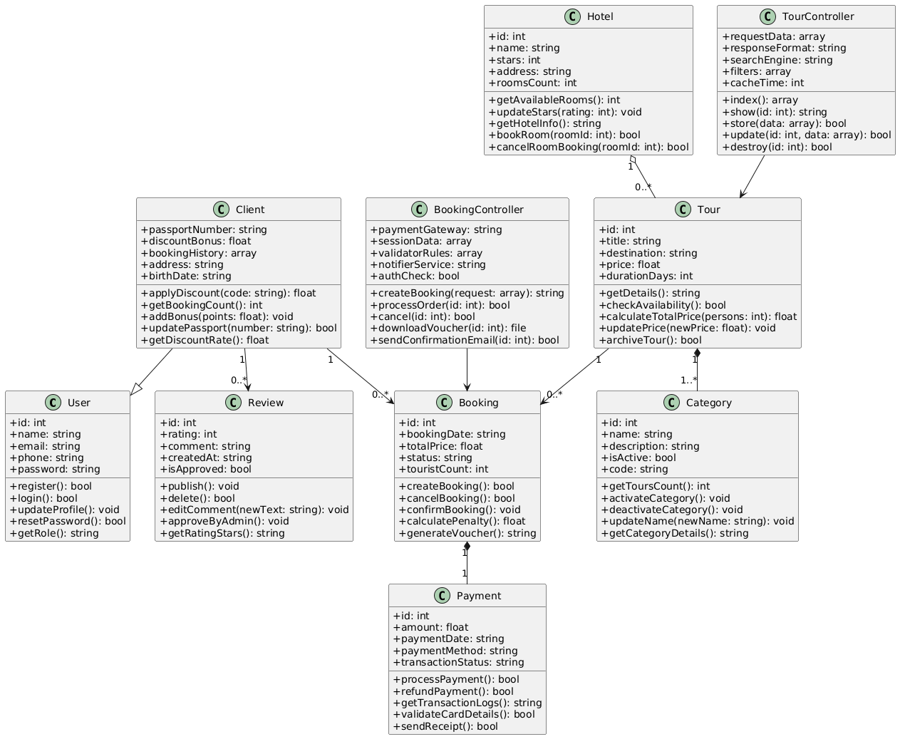

# Архітектура електронної системи для туристичного оператора

## 1. Аналіз предметної галузі
* **Призначення ПЗ та основні функції:** Пошук турів, вибір готелю, бронювання, онлайн-оплата, генерація PDF-ваучера, скасування бронювання.
* **Користувачі:** Користувач (базовий), Турист (клієнт), Менеджер з туризму, Адміністратор.
* **Архітектура:** MVC (Model-View-Controller).
* **Сутності БД:** User, Client, Tour, Hotel, Category, Booking, Payment, Review.
* **Вихідні дані:** Електронний туроваучер (PDF), список тургрупи, статистика продажів.

## 2. Повна форма Use Case (Бронювання туру)
* **Primary Actor:** Турист.
* **Main Success Scenario:**
  1. Турист обирає країну та місто відпочинку.
  2. Турист обирає бажані дати поїздки.
  3. Система відображає розклад доступних туристичних турів.
  4. Турист обирає конкретний тур.
  5. Система відображає доступні готелі та категорії номерів.
  6. Турист обирає готель.
  7. Система фіксує бронь за туристом на 15 хвилин та розраховує підсумкову вартість.
  8. Турист вводить дані платіжної картки.
  9. Система обробляє транзакцію через банківський шлюз.
  10. Система генерує PDF-ваучер, зберігає його в БД та відправляє на email.
* **Extensions:**
  3a. На обрану дату немає турів: пропозиція сусідніх дат.
  6a. Номер заброньовано: вибір іншого номера.
  8a. Час бронювання (15 хв) вичерпано: скасування бронювання.
  9a. Відхилення оплати банком: повідомлення про помилку.
  9b. Введення промокоду: перерахунок суми.

## 3. Спроєктовані UML-діаграми

